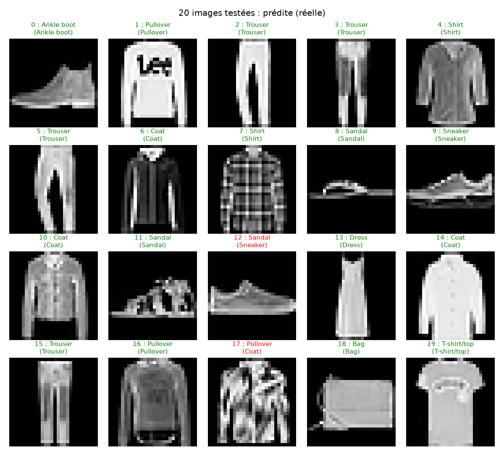
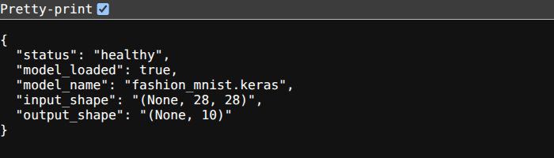
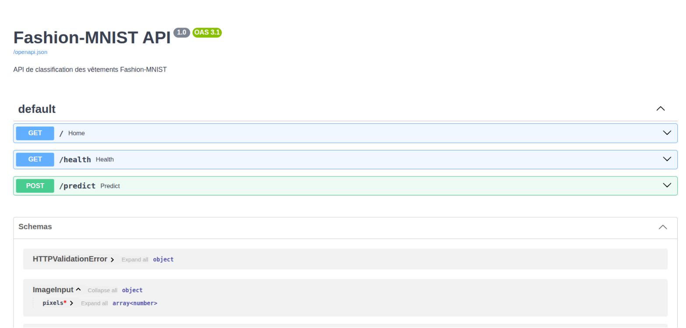
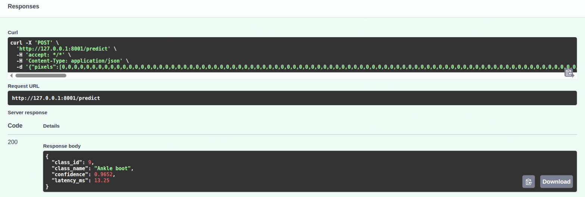
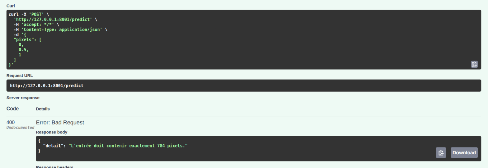

# Déploiement d’un modèle Fashion-MNIST avec FastAPI

API web qui sert un modèle de classification **Fashion-MNIST** (Keras) : elle reçoit une image sous la forme de **784 pixels** et retourne sa **classe**, son **score de confiance** et la **latence d’inférence**.

> TP de déploiement — Module *Framework du Machine Learning & Deep Learning*
> Master SDIA — ENSET Mohammedia, Université Hassan II de Casablanca
> Encadré par **Pr. OUHMIDA Asmae**


---

## Sommaire

- [Aperçu](#aperçu)
- [Structure du projet](#structure-du-projet)
- [Le modèle](#le-modèle)
- [Contrat d’inférence](#contrat-dinférence)
- [Installation](#installation)
- [Lancer l’API](#lancer-lapi)
- [Utiliser l’API](#utiliser-lapi)
- [Tests](#tests)
- [Résultats](#résultats)
- [Captures](#captures)
- [Rapport](#rapport)
- [Auteurs](#auteurs)

---

## Aperçu

| Route | Méthode | Rôle |
|---|---|---|
| `/` | GET | Message d’accueil |
| `/health` | GET | Vérifie que le serveur tourne et que le modèle est chargé |
| `/predict` | POST | Prédit la classe d’une image de 784 pixels |
| `/docs` | GET | Documentation interactive Swagger (générée par FastAPI) |

Points clés :

- le modèle est **chargé une seule fois** au démarrage du serveur ;
- l’entrée est **validée** : une liste qui ne contient pas exactement 784 pixels est refusée avec une erreur **HTTP 400** ;
- les pixels sont **normalisés** automatiquement (division par 255) s’ils sont fournis entre 0 et 255 ;
- la **latence** de l’inférence est mesurée côté serveur et renvoyée dans la réponse.

---

## Structure du projet

```
fastapi-fashion-mnist-deploiement/
├── app.py                  # API FastAPI (/, /health, /predict)
├── test_api.py             # tests : 1 image, 20 images, entrée incorrecte
├── requirements.txt        # dépendances Python
├── fashion_mnist.keras     # modèle entraîné (1,2 Mo)
├── resultats.json          # résultats produits par test_api.py
├── captures/               # captures d’écran et figures
│   ├── swagger.png
│   ├── health.png
│   ├── prediction.png
│   ├── entree_incorrecte.png
│   ├── image_testee.png
│   └── predictions_20.png
├── rapport/
│   ├── compte_rendu.docx
│   └── compte_rendu.pdf
├── .gitignore
└── README.md
```

---

## Le modèle

Réseau de neurones dense (MLP) entraîné sur Fashion-MNIST (60 000 images d’entraînement, 10 000 de test, images 28 × 28 en niveaux de gris) :

```
Flatten (28, 28) → 784
Dense 128, ReLU
Dense 10          → logits (une valeur par classe)
```

- Entrée : `(None, 28, 28)` — Sortie : `(None, 10)` (logits, sans softmax)
- Précision sur le jeu de test complet : **88,1 %**

| ID | Classe | ID | Classe |
|---|---|---|---|
| 0 | T-shirt/top | 5 | Sandal |
| 1 | Trouser | 6 | Shirt |
| 2 | Pullover | 7 | Sneaker |
| 3 | Dress | 8 | Bag |
| 4 | Coat | 9 | Ankle boot |

---

## Contrat d’inférence

| Élément | Spécification |
|---|---|
| Route | `POST /predict` |
| Entrée | JSON `{"pixels": [...]}` — 784 nombres (image 28 × 28 aplatie), valeurs dans `[0, 255]` ou `[0, 1]` |
| Validation | Exactement 784 valeurs, sinon **HTTP 400** avec un message explicite |
| Prétraitement | `float32` → batch `(1, 28, 28)` → division par 255 si `max > 1` |
| Modèle | `fashion_mnist.keras`, exécuté avec `training=False` |
| Post-traitement | `softmax` sur les logits, `argmax` pour la classe, probabilité max pour la confiance |
| Sortie | JSON `{class_id, class_name, confidence, latency_ms}` |

Étapes de la route `/predict` (voir [`app.py`](app.py)) :

1. recevoir la liste `pixels` ;
2. vérifier qu’elle contient exactement 784 valeurs ;
3. la convertir en tableau NumPy `float32` ;
4. la remettre en forme `(1, 28, 28)` ;
5. normaliser si les valeurs sont entre 0 et 255 ;
6. exécuter le modèle avec `training=False` ;
7. transformer les logits en probabilités (`softmax`) ;
8. déterminer la classe la plus probable (`argmax`) ;
9. calculer le score de confiance ;
10. mesurer la latence avec `time.perf_counter()` ;
11. retourner le résultat en JSON.

---

## Installation

Prérequis : **Python 3.10 à 3.12** (versions compatibles avec TensorFlow).

```bash
git clone https://github.com/<votre-compte>/fastapi-fashion-mnist-deploiement.git
cd fastapi-fashion-mnist-deploiement

python -m venv .venv
source .venv/bin/activate          # Windows : .venv\Scripts\activate

pip install -r requirements.txt
```

---

## Lancer l’API

```bash
uvicorn app:app --reload
```

Au démarrage, la console affiche :

```
Chemin du modèle : .../fashion_mnist.keras
Fichier trouvé : True
Modèle chargé avec succès
Forme d'entrée : (None, 28, 28)
Forme de sortie : (None, 10)
```

- API : http://127.0.0.1:8000
- Swagger : http://127.0.0.1:8000/docs
- Santé : http://127.0.0.1:8000/health

> Si le port 8000 est déjà utilisé : `uvicorn app:app --port 8001`

---

## Utiliser l’API

### `GET /health`

```bash
curl http://127.0.0.1:8000/health
```

```json
{
  "status": "healthy",
  "model_loaded": true,
  "model_name": "fashion_mnist.keras",
  "input_shape": "(None, 28, 28)",
  "output_shape": "(None, 10)"
}
```

### `POST /predict`

Depuis Python :

```python
import requests
import tensorflow as tf

(_, _), (x_test, y_test) = tf.keras.datasets.fashion_mnist.load_data()

payload = {"pixels": x_test[0].reshape(784).astype(float).tolist()}
response = requests.post("http://127.0.0.1:8000/predict", json=payload)
print(response.json())
```

Réponse :

```json
{
  "class_id": 9,
  "class_name": "Ankle boot",
  "confidence": 0.9652,
  "latency_ms": 3.4
}
```

### Entrée incorrecte

```bash
curl -X POST http://127.0.0.1:8000/predict \
     -H "Content-Type: application/json" \
     -d '{"pixels": [0.0, 0.5, 1.0]}'
```

Réponse (HTTP **400**) :

```json
{ "detail": "L'entrée doit contenir exactement 784 pixels." }
```

---

## Tests

Avec le serveur lancé, dans un second terminal :

```bash
python test_api.py
```

Le script :

1. charge Fashion-MNIST ;
2. **teste une image** (indice 0) : affiche la réponse, compare classe réelle et prédite, affiche l’image ;
3. **teste 20 images** : affiche le tableau, le nombre de prédictions correctes et la latence moyenne ;
4. **teste une entrée incorrecte** (3 pixels) ;
5. enregistre les résultats dans `resultats.json` et les figures dans `captures/`.

Si l’API tourne sur un autre port :

```bash
API_URL=http://127.0.0.1:8001/predict python test_api.py
```

---

## Résultats

Test sur les 20 premières images du jeu de test :

| Image | Classe réelle | Classe prédite | Confiance | Latence | Résultat |
|---:|---|---|---:|---:|---|
| 0 | Ankle boot | Ankle boot | 0,97 | 3,40 ms | ✅ Correct |
| 1 | Pullover | Pullover | 0,99 | 3,58 ms | ✅ Correct |
| 2 | Trouser | Trouser | 1,00 | 3,70 ms | ✅ Correct |
| 3 | Trouser | Trouser | 1,00 | 3,26 ms | ✅ Correct |
| 4 | Shirt | Shirt | 0,68 | 3,46 ms | ✅ Correct |
| 5 | Trouser | Trouser | 1,00 | 3,80 ms | ✅ Correct |
| 6 | Coat | Coat | 0,99 | 4,09 ms | ✅ Correct |
| 7 | Shirt | Shirt | 0,99 | 3,74 ms | ✅ Correct |
| 8 | Sandal | Sandal | 1,00 | 3,38 ms | ✅ Correct |
| 9 | Sneaker | Sneaker | 1,00 | 3,95 ms | ✅ Correct |
| 10 | Coat | Coat | 0,98 | 3,18 ms | ✅ Correct |
| 11 | Sandal | Sandal | 1,00 | 3,08 ms | ✅ Correct |
| 12 | Sneaker | Sandal | 0,93 | 3,23 ms | ❌ Incorrect |
| 13 | Dress | Dress | 1,00 | 3,16 ms | ✅ Correct |
| 14 | Coat | Coat | 0,82 | 2,91 ms | ✅ Correct |
| 15 | Trouser | Trouser | 1,00 | 3,27 ms | ✅ Correct |
| 16 | Pullover | Pullover | 0,98 | 3,27 ms | ✅ Correct |
| 17 | Coat | Pullover | 0,69 | 3,45 ms | ❌ Incorrect |
| 18 | Bag | Bag | 1,00 | 4,48 ms | ✅ Correct |
| 19 | T-shirt/top | T-shirt/top | 0,99 | 4,09 ms | ✅ Correct |

| Indicateur | Valeur |
|---|---|
| Prédictions correctes | **18 / 20** |
| Taux de réussite | **90 %** |
| Latence moyenne | **3,52 ms** |
| Latence min / max | 2,91 ms / 4,48 ms |
| Confiance moyenne (correctes / incorrectes) | 0,97 / 0,81 |
| Entrée de 3 pixels | refusée, **HTTP 400** |

**Analyse.** Les deux erreurs concernent des classes visuellement proches (*Sneaker* / *Sandal*, *Coat* / *Pullover*). La confiance moyenne des erreurs est plus faible que celle des bonnes prédictions, ce qui en fait un indicateur utile, mais pas infaillible (l’image 12 est mal classée avec 0,93 de confiance). La latence reste faible et stable car le modèle est déjà en mémoire.



---

## Captures

| `/health` | Swagger (`/docs`) |
|---|---|
|  |  |

| Prédiction via Swagger | Entrée incorrecte (400) |
|---|---|
|  |  |

---

## Rapport

Le compte rendu complet (contrat d’inférence, résultats, analyse, réponses aux questions et conclusion) est disponible dans le dossier [`rapport/`](rapport/) :

- [compte_rendu.pdf](rapport/compte_rendu.pdf)
- [compte_rendu.docx](rapport/compte_rendu.docx)

---

## Auteurs

- **AIT EL MAHJOUB Abdessamad**
- **OUAOUCHE Hicham**

Master SDIA — ENSET Mohammedia — Année universitaire 2026–2027
